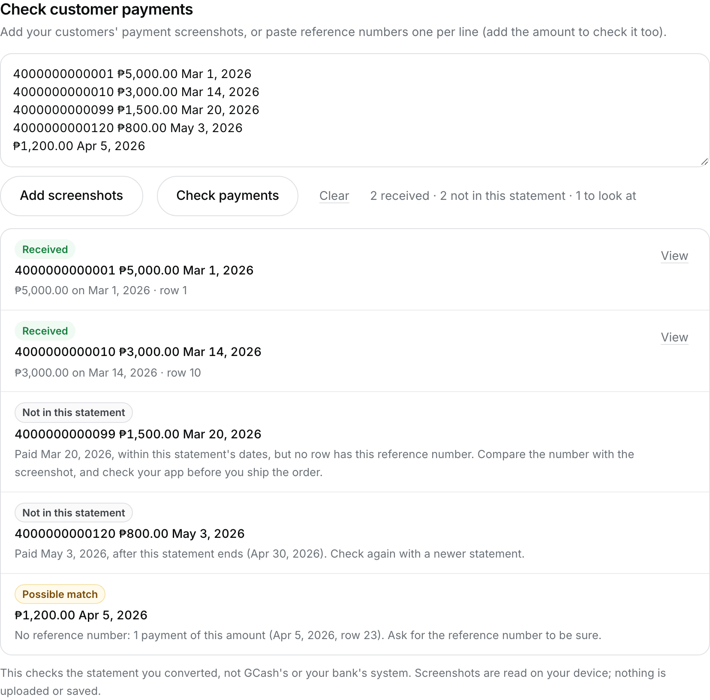

<!-- Search intent: "gcash reference number checker", "gcash reference number tracker", "check gcash payment", "gcash proof of payment". -->
<!-- Receipt layouts below were checked against real GCash receipts (2026-11-09): "Sent via GCash" (Amount, Total Amount Sent, Ref No. with 13 digits, date and time) and a QR payment ("Reference No.", "QRPH Invoice No."). -->
<!-- Never say a payment is fake or that this checks GCash's own system: it checks the seller's statement only. -->

If you sell online, you've probably been sent a payment screenshot and wondered whether the money
really arrived. A screenshot is only a picture. What counts is whether the payment shows up in
**your own** GCash transaction history.

Checking that one payment at a time in the app works for a few orders. When you have a dozen, or
you're catching up at the end of the week, the free [statement converter](/) can check them all at
once against your statement, on your device.

## What's on a GCash payment receipt

When a customer pays you with **Send Money**, their receipt (the screen they screenshot) shows:

- your name, partly hidden, and your mobile number
- **Amount** and **Total Amount Sent**
- **Ref No.**, a 13-digit reference number
- the date and time of the payment

Receipts for QR payments look a little different: the number is labelled **Reference No.**, and
there's also a **QRPH Invoice No.**, which is not the reference number.

The reference number is the part to check. TODO: verify that the reference number on the sender's
receipt is the same one shown in the receiver's GCash transaction history (compare a real received
payment's receipt with the receiver's statement).

## How to check payments against your statement

**1. Get your transaction history.** Request the PDF for the dates your orders came in. Our guide
shows [how to download your GCash transaction history](/blog/how-to-download-gcash-transaction-history).

**2. Convert it.** Open the [converter](/), choose the PDF and enter its password. Everything is
read in your browser; nothing is uploaded.

**3. Add your customers' screenshots.** Under **Check customer payments**, tap **Add screenshots**
and choose the payment screenshots (you can pick several at once). The converter reads the
reference number, amount and date from each picture and puts them in the box, one line per
payment.

You can also type or paste reference numbers yourself, one per line, with the amount if you want
it checked too.

**4. Check the numbers, then tap Check payments.** Reading text from a picture isn't perfect, so
glance at each line and compare it with the screenshot before you rely on the result. Fix any digit
that was misread.

## What the results mean

- **Received**: your statement has money coming in with this reference number, for the same amount
  if you gave one. **View** jumps to that row in your transactions.
- **Amount differs**: the reference number is there, but for a different amount. Ask the customer
  about it.
- **Not money in**: the reference number is in your statement, but as money going _out_ of your
  account. That isn't a payment to you.
- **Possible match**: you only gave an amount, so the converter lists payments of that amount
  around that date. More than one customer can pay the same amount, so ask for the reference number
  to be sure.
- **Not in this statement**: no row has this reference number. The date tells you why:
  - _paid after the statement ends_: your statement is older than the payment. Download a newer
    one and check again.
  - _paid within the statement's dates_: compare the number with the screenshot first (one wrong
    digit is enough to miss it). If it still isn't there, check your GCash app before you send the
    order.

## Is it private?

Yes. The statement, the screenshots and the numbers are all handled in your browser. The converter
doesn't upload them, save them, or send them anywhere, and "Convert another" clears them. Read the
[privacy page](/privacy) for details.

## Good habits for payments by screenshot

- Check payments **before** you ship or deliver, not after.
- Ask customers to send the full receipt screen, not a cropped one: the reference number and date
  are what you need.
- For a payment made a few minutes ago, your GCash app is the quickest place to look. The statement
  check is best for many payments at once.
- Keep your converted Excel file: it's a tidy record of who paid what, and when.
