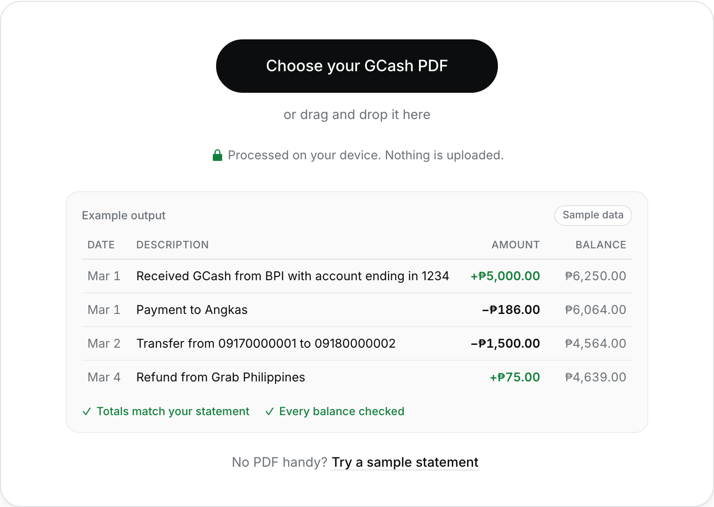
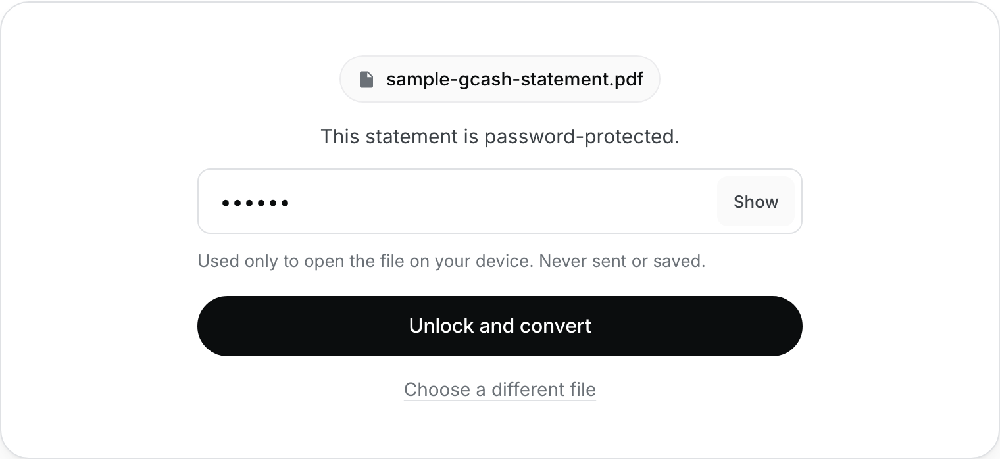
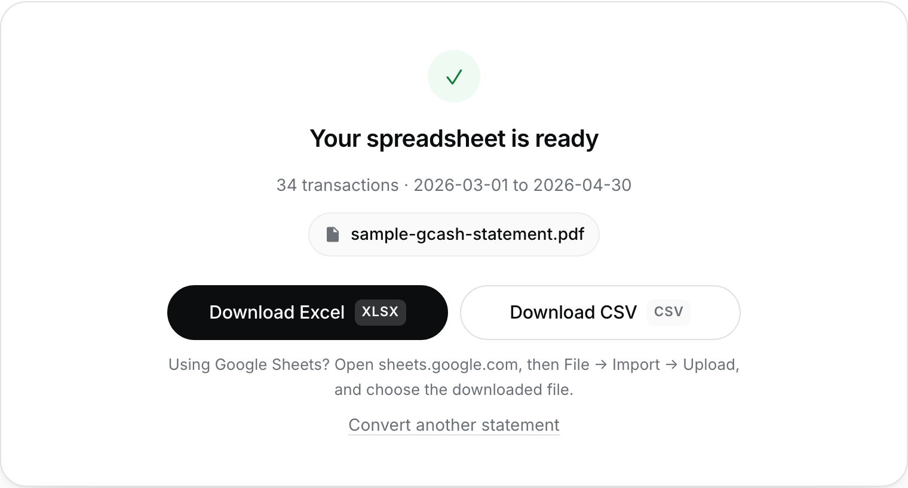
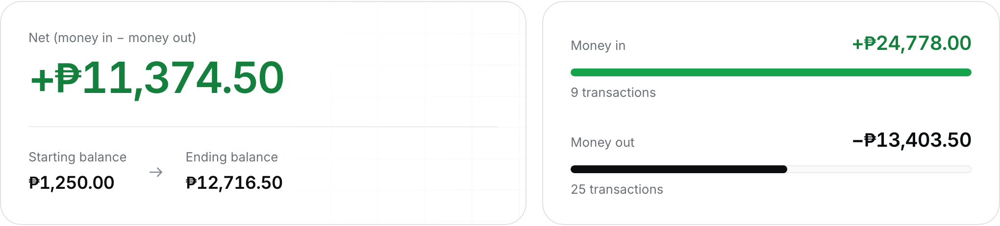
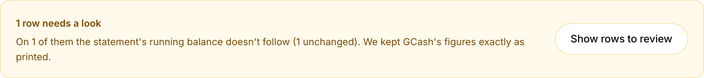
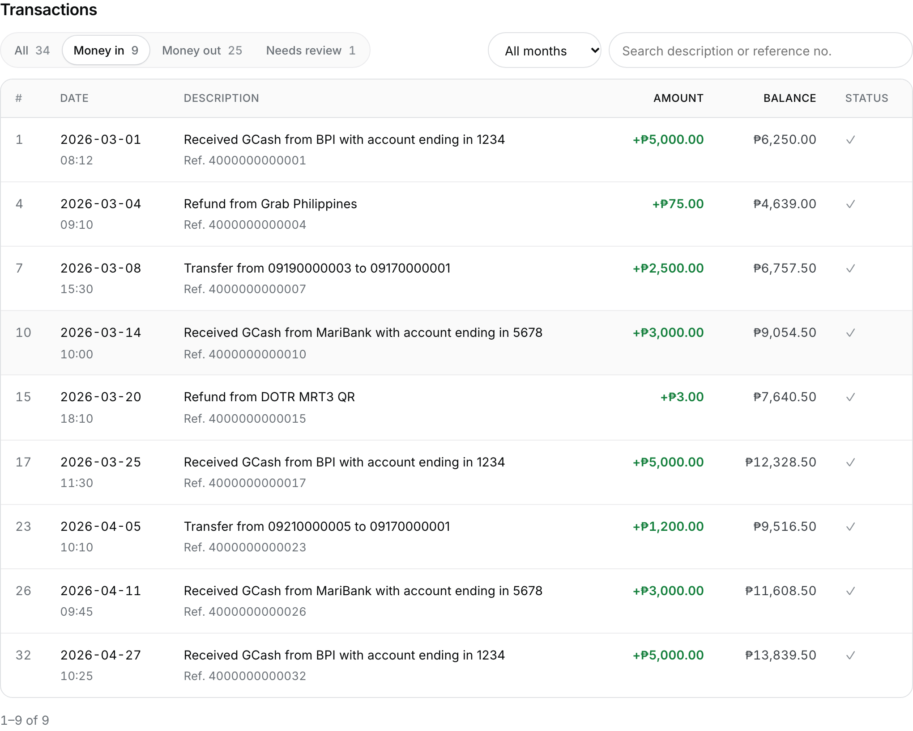

<!-- Search intent: "gcash statement to excel", "convert gcash pdf to excel". -->
<!-- Screenshots: made from the FAKE sample statement only (node scripts/make-blog-screenshots.mjs). -->

This guide shows how to turn your GCash Transaction History PDF into an Excel file with the free
[GCash statement converter](/). It works on phones and computers, and your statement is processed
on your device. Nothing is uploaded.

Want to see it first? Press **Try a sample statement** on the [converter](/) to run it on a
made-up statement. All the screenshots below come from that sample.

## What you need

- Your GCash Transaction History PDF, requested from the GCash app.
- The password that came with the PDF. GCash statements are password-protected.
- A modern browser such as Chrome, Safari, Edge or Firefox, on your phone or computer.

## Step 1: Choose your PDF

Open the [converter](/) and press **Choose your statement**. On a computer you can also drag the
file onto the box.

## Step 2: Enter the password

GCash statements are password-protected, so you'll be asked for the password. Type it and press
**Unlock and convert**. Use **Show** to check what you typed. If it's wrong, you'll be asked to try
again.

The password is only used to open the file on your device. It's never sent anywhere or saved, and
it's cleared after converting.

## Step 3: Download Excel or CSV

When it's done, you'll see **Your spreadsheet is ready** with the number of transactions and the
statement period, and a quick check against your statement. Press **Download Excel** or
**Download CSV**.

The Excel workbook has two sheets:

| Sheet        | What's in it                                                                                                           |
| ------------ | ---------------------------------------------------------------------------------------------------------------------- |
| Transactions | Date, time, description, reference no., debit, credit, balance, balance check, notes, with filters and a frozen header |
| Summary      | Period, starting and ending balance, totals, accuracy checks, and money in/out per month                               |

The CSV opens in Excel, Google Sheets, Numbers and most accounting tools.

## Step 4: Check the results against your PDF

Press **View all transactions** (or scroll down) to see the statement details. Use them to make sure everything was
read correctly before you rely on the spreadsheet.

**Overview.** Money in and money out for the whole period, the net, and your starting and ending
balance.

**Rows to review.** Sometimes a statement lists a transaction but its running balance doesn't
change, or changes by a different amount. WalletToExcel keeps GCash's figures exactly as printed
and points those rows out. Press **Show them** to see only those rows, then compare them with
the GCash app.

**Transactions.** Every row, 20 per page. Filter by **Money in**, **Money out** or **Needs review**,
pick a month, or search by description or reference number to find a row from your PDF quickly.
Turn on **Clean up** to leave out transactions that didn't change your balance; it also applies to
your download.

## Step 5: Open it

- **Excel:** open the downloaded file.
- **Google Sheets:** go to sheets.google.com, then **File → Import → Upload**, and choose the
  downloaded file. If you upload the Excel file, you get both sheets.

## Troubleshooting

- **Asked for a password:** type the password that came with your statement, then press
  **Unlock and convert**. If it says "Wrong password", check uppercase letters and extra spaces.
- **"This PDF has no readable text":** screenshots and scanned images can't be converted. Use the
  original PDF from GCash.
- **"We couldn't find a transaction table in this PDF":** the file isn't a statement with a table
  of dates and amounts. Use the Transaction History PDF that GCash sends you.
- **Some rows have a ⚠ sign:** their running balance doesn't follow (hover it to see why); see Step 4. The figures come straight from your statement;
  nothing is changed.
